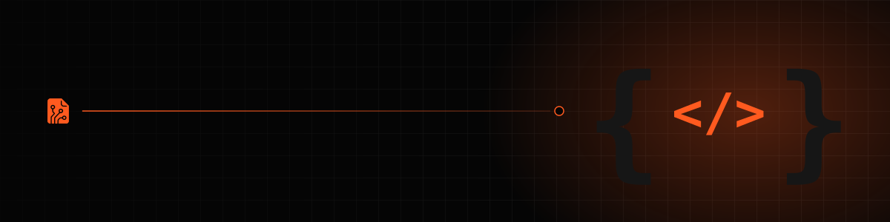
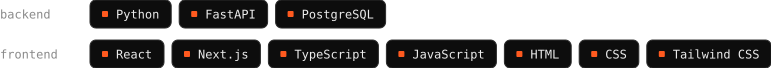

  

# Hi, I'm Luis Rafael Eyoma 👋

**Self-taught Full-Stack Developer** · *Building practical software for real-world problems.*

Based in Bata, Equatorial Guinea. I build web apps and offline-first tools, and I'm increasingly interested in data analysis.

## Stack

## Featured projects
<table>
  <tr>
    <td width="50%" valign="top">
      
      <h3><a href="https://github.com/luisrafaeleyoma/raices">Raíces</a></h3>
      Cultural heritage platform preserving the oral traditions and myths of Equatorial Guinea's ethnic groups. 
      Next.js · TypeScript · Supabase 
      <a href="https://raiceseg.vercel.app/">Live site</a>
    </td>
    <td width="50%" valign="top">
      
      <h3><a href="https://github.com/luisrafaeleyoma/cdgq">Xenon.py community site</a></h3>
      Official website of Xenon.py, built to attract volunteers and showcase local projects. 
      Next.js · TypeScript · Tailwind 
      <a href="https://communityeg.vercel.app/">Live site</a>
    </td>
  </tr>
</table>

**[GES](https://github.com/luisrafaeleyoma/ges)** *(in development)*: school management system for educational centers, designed to work offline over a local network.

## Beyond my own work
I founded [Xenon.py](https://communityeg.vercel.app/), a local initiative that builds offline-first software adapted to our context, to help reduce the digital divide.
